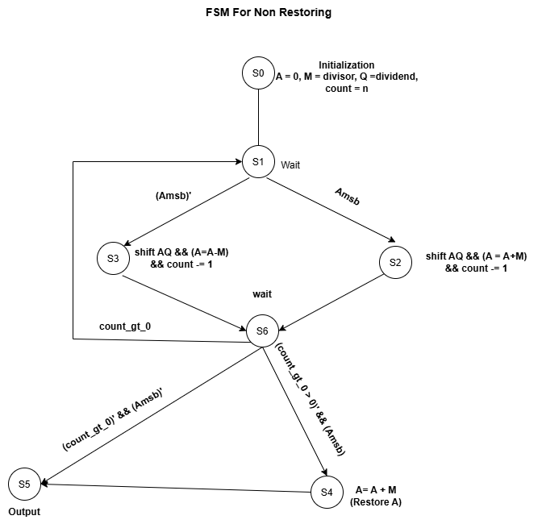
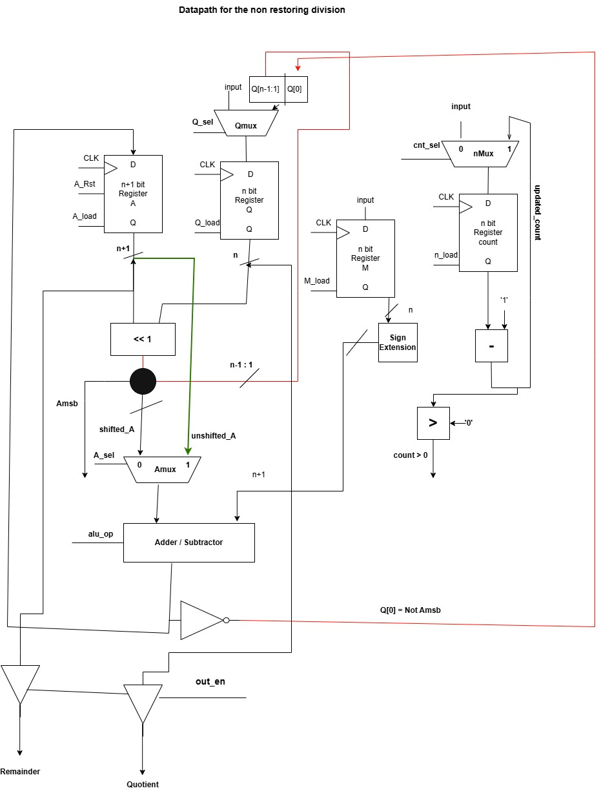
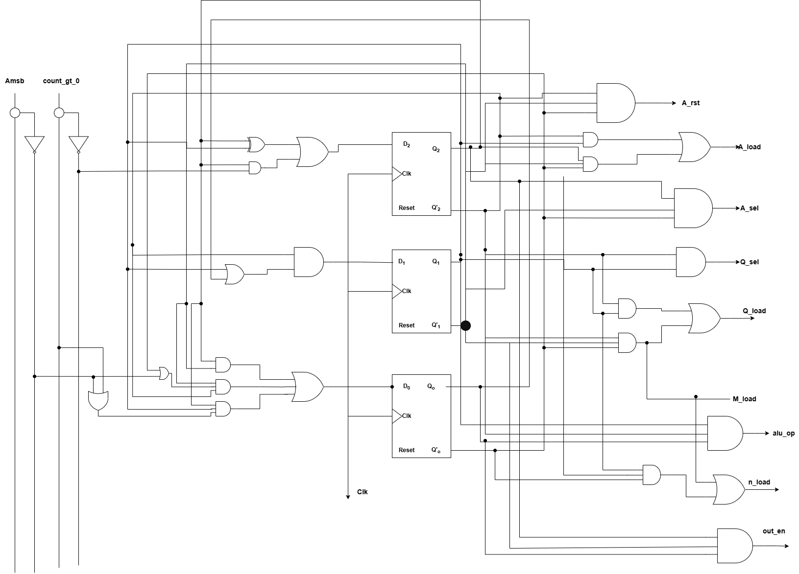
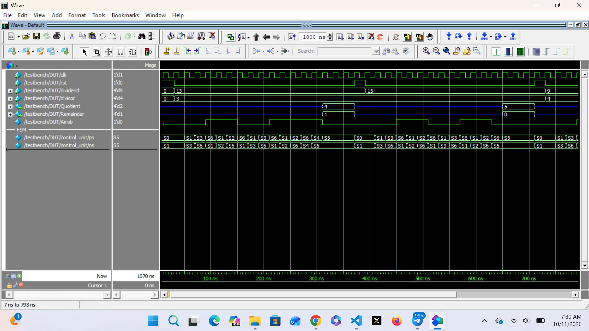
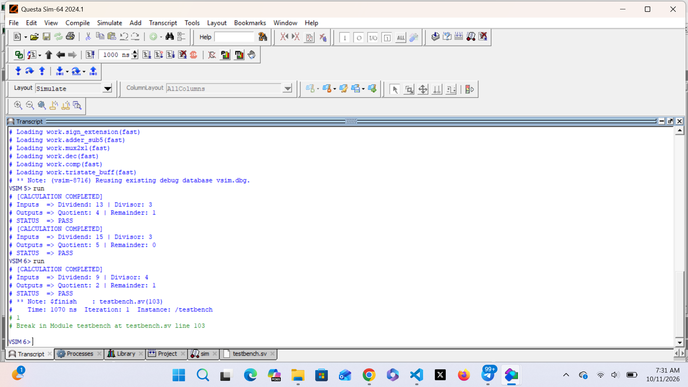

<div align="center">

# Non-Restoring Division Hardware Accelerator

**A synchronous non-restoring divider, designed as an FSM + datapath and verified in SystemVerilog**


[Overview](#overview) |
[Architecture](#architecture-and-design) |
[Logic Minimization](#mathematical-proofs-and-logic-minimization) |
[Verification](#verification-and-simulation-results) |
[Quick Start](#quick-start) |
[Repository Structure](#repository-structure)

</div>

---

## Overview

This project implements a **synchronous non-restoring division** unit in hardware. Instead of restoring the accumulator after every failed subtraction (as in restoring division), the non-restoring method alternates between subtraction and addition based on the sign of the partial remainder, and applies a **single correction step at the end**. This removes one operation from each iteration and shortens the critical path.

The design is split into a **Moore finite state machine (control unit)** and a **datapath** (registers, ALU, shifter, counter). Both were derived by hand from the algorithm, with the next-state logic minimized using Karnaugh maps, then implemented in SystemVerilog and verified with an exhaustive testbench on **QuestaSim** and **Cadence Xcelium**.

### Key Highlights

| Area | Detail |
| --- | --- |
| Algorithm | Synchronous non-restoring division, n clock cycles plus a final correction stage |
| Design Method | Algorithm analysis, datapath design, FSM design, circuit diagram, logic equation derivation, optimization |
| Control Unit | 7-state Moore FSM, 3-bit state encoding |
| Implementation | SystemVerilog RTL (top, datapath, control unit, ALU) |
| Verification | Self-checking testbench with timestamped traces |
| Tools | QuestaSim, Cadence Xcelium, Xilinx Vivado |

---

## Algorithm

**Registers:** `A` is the accumulator (n+1 bits), `M` the divisor (n bits), `Q` the dividend (n bits), and `count` the loop counter.

**Step 1: Initialization**

```text
A     = 00000      (accumulator, n + 1 bits)
M     = Divisor    (n bits)
Q     = Dividend   (n bits)
count = n
```

**Step 2: Main loop (repeated for n clock cycles)**

1. Shift the combined register pair `[A, Q]` left by one bit.
2. Conditional arithmetic:
   - If the previous `A >= 0` (MSB of A = 0): `A = A - M`
   - Else (MSB of A = 1): `A = A + M`
3. Quotient bit insertion:
   - If the new `A >= 0`: `Q0 = 1`
   - Else: `Q0 = 0`
4. `count = count - 1`

**Step 3: Final correction**

- If final `A < 0`: restore the remainder, `A = A + M`
- If final `A >= 0`: no restoration needed

The quotient is in `Q` and the remainder is in `A`.

---

## Architecture and Design

### Block Overview

The control unit observes two status signals from the datapath and drives the datapath control signals each cycle.

| Direction | Signal | Meaning |
| --- | --- | --- |
| Datapath to control | `Amsb` | Sign bit of A (a direct wire tap, not a comparator) |
| Datapath to control | `count>0` | Loop-continue flag from the decrementer output |
| Control to datapath | `A_Rst`, `A_load`, `A_sel` | Accumulator reset, load enable, and input select |
| Control to datapath | `Q_load`, `Q_sel` | Dividend/quotient register load and input select |
| Control to datapath | `M_load` | Divisor register load |
| Control to datapath | `alu_op` | Selects subtract or add |
| Control to datapath | `cnt_sel`, `n_load` | Counter load and decrement control |
| Control to datapath | `out_en` | Output enable |

### Control Unit FSM

A 7-state Moore machine. The decrement happens in the same state as the shift and arithmetic operation, so the loop needs no separate counter state.

| State | Code | Function |
| --- | --- | --- |
| S0 | 000 | Initialize registers |
| S1 | 001 | Wait and branch on `Amsb` |
| S2 | 010 | Shift left, add, decrement (`Amsb = 1`) |
| S3 | 011 | Shift left, subtract, decrement (`Amsb = 0`) |
| S6 | 110 | Wait; loop to S1 while `count>0`, otherwise branch on `Amsb` |
| S4 | 100 | Restore: `A = A + M`, write back to register |
| S5 | 101 | Output result (self-loop) |



*Figure 1. Moore FSM state diagram.*

### Datapath



*Figure 2. Datapath: registers A, Q, M, counter, shifter and add/subtract ALU.*

### Circuit Diagram



*Figure 3. Gate-level circuit of the control unit next-state logic.*

---

## Mathematical Proofs and Logic Minimization

State bits are `Q2 Q1 Q0`. Let `X = Amsb` and `Y = (count > 0)`. The next-state equations were derived from the state transition table and minimized with Karnaugh maps. Primes denote complement.

```text
D2 = (Q2 ^ Q1) + Q2 Q1 Q0' Y'

D1 = Q2' (Q1 + Q0)

D0 = Q2' Q1' (Q0' + X') + Q2 Q1' + Q2 Q1 Q0' (Y + X')
```

**Notes**

- The unused state code `111` is assigned so that it **self-corrects to S0**. This is a deliberate design choice for robustness; the don't-care could be assigned differently for a more minimal expression.
- Control signals are Moore outputs, so each depends only on the current state. The full control word table (one row per state) is documented in [`docs/`](docs/).
- The complete derivations, state transition table, and K-maps are in the LaTeX report under [`docs/`](docs/).

---

## Verification and Simulation Results

The testbench drives the divider, waits for completion, and compares the quotient and remainder against the expected values computed by the reference model, printing a timestamped trace for every transaction.

### Directed Test Cases (n = 4)

| Test | Dividend | Divisor | Expected Quotient | Expected Remainder | Final Restore (S4) |
| --- | --- | --- | --- | --- | --- |
| 1 | 13 | 3 | 4 | 1 | Exercised |
| 2 | 15 | 3 | 5 | 0 | Not needed |
| 3 | 9 | 4 | 2 | 1 | Exercised |

Cases 1 and 3 end with a negative accumulator and exercise the correction state; case 2 ends non-negative and skips it, so both paths of the final-stage branch are covered.

### Simulation Waveform



*Figure 4. Waveform showing state transitions, `A`, `Q`, `count`, and the final quotient and remainder.*

### Console Output

*Figure 5. Console output showing the passed test cases.*

---

## Quick Start

### Prerequisites

- Siemens QuestaSim **or** Cadence Xcelium
- (Optional) Xilinx Vivado for synthesis and implementation

### QuestaSim

```bash
cd sim
vlib work
vlog -sv ../rtl/*.sv ../testbench/*.sv
vsim -c work.top -do "run -all; quit"
```

For the GUI and waveforms:

```bash
vsim work.top -do "add wave -r /*; run -all"
```

### Xcelium

```bash
cd sim
xrun -sv -access +rwc ../rtl/*.sv ../testbench/*.sv -top top
```

With the SimVision waveform viewer:

```bash
xrun -sv -access +rwc -gui ../rtl/*.sv ../testbench/*.sv -top top
```

---

## Repository Structure

```text
.
|-- docs/         LaTeX reports and proof documentation
|-- rtl/          SystemVerilog RTL: top, datapath, control unit, ALU
|-- testbench/    Testbench with timestamped traces
|-- sim/          Run scripts and instructions for QuestaSim and Xcelium
`-- assets/       fsm_diagram.png, datapath_schematic.png,
                  circuit_diagram.png, simulation_waveform.png
```

---

## Skills Demonstrated


---

## Author

**Asiedu Seth Osei**

Computer Engineering, Kwame Nkrumah University of Science and Technology (KNUST)

[](https://github.com/asieducodes)
[](https://www.linkedin.com/)
